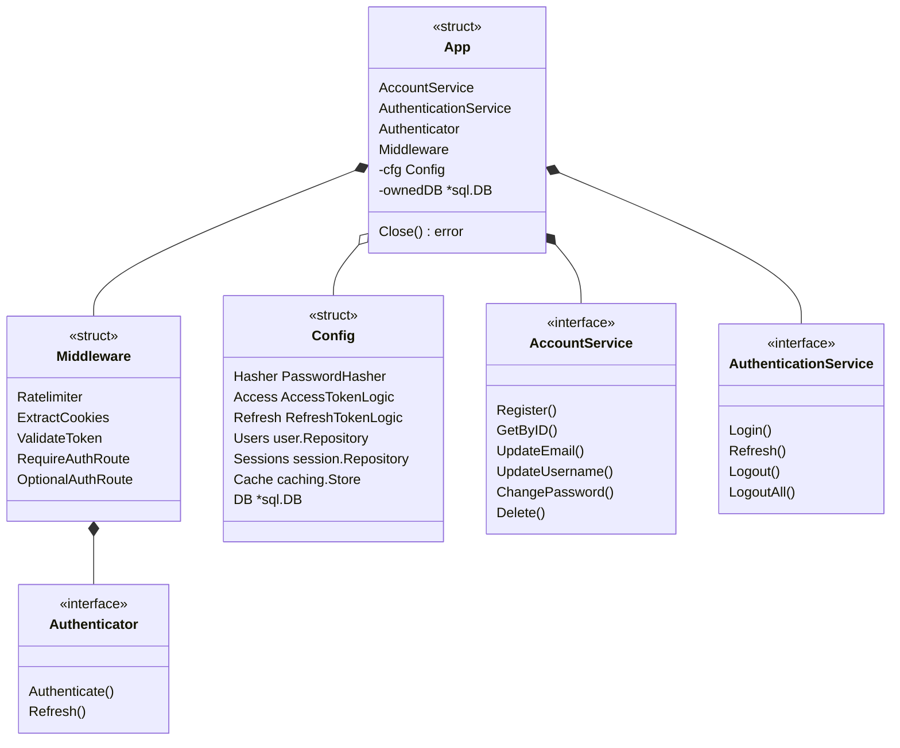
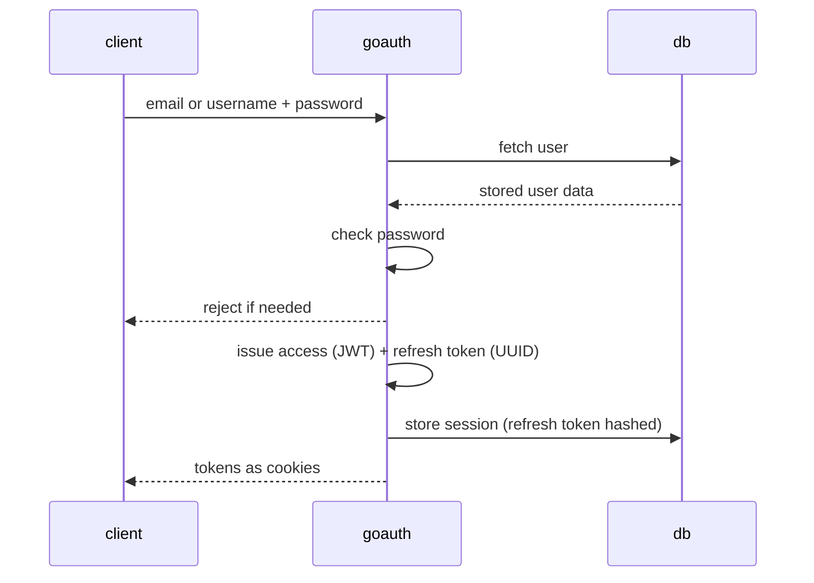
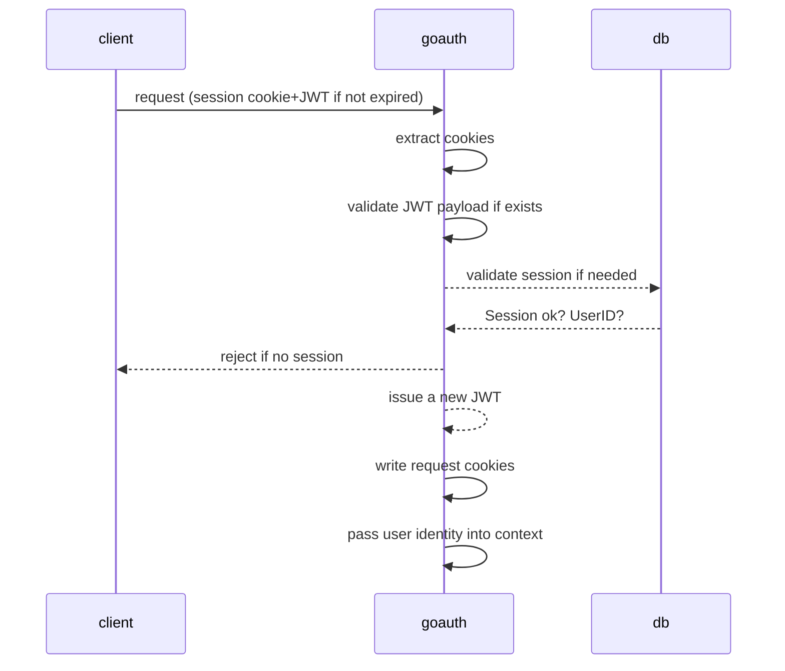
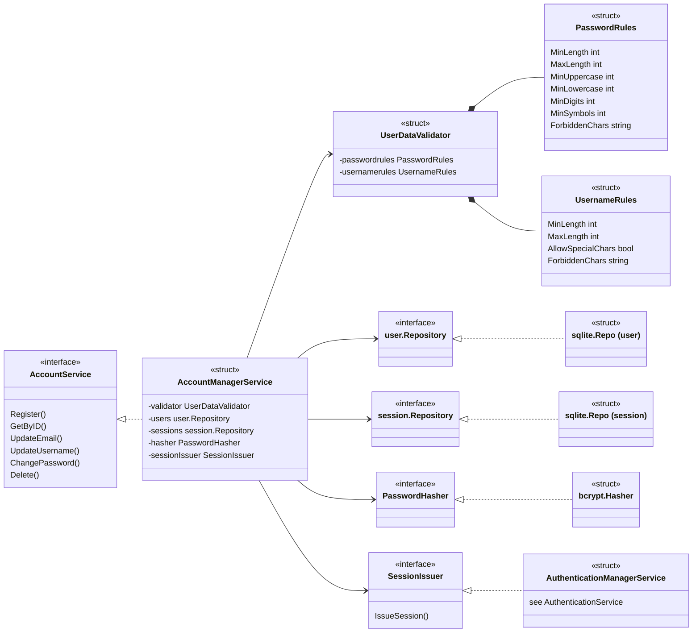
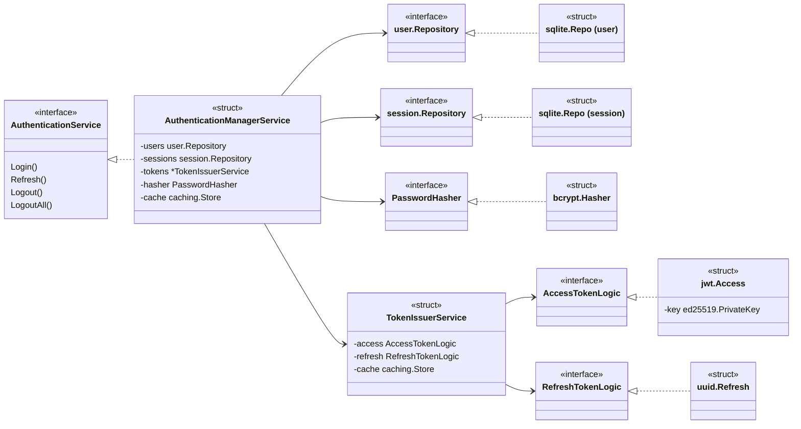

# goauth

Not ready. 

Cookie based authentication for Go services: register, login, refresh, logout. Every part sits behind an interface and has a default, so it works with zero config and almost any part can be swapped.

## Quick start

```sh
go get github.com/markusnieminen1/goauth
```

```go
package main

import (
	"context"
	"log"
	"net/http"

	"github.com/markusnieminen1/goauth"
	"github.com/markusnieminen1/goauth/domain/sharedmodels"
)

func main() {
	app, err := goauth.NewAuthApp(goauth.Config{})
	if err != nil {
		log.Fatal(err)
	}
	defer app.Close()

	ctx := context.Background() // Normally you use r.Context() in handlers 

	cookies, err := app.AccountService.Register(ctx, sharedmodels.RegisterInput{Email: "a@b.fi", Username: "alice", Password: "Turb0!Secure"})
	if err != nil {
		log.Fatal(err)
	}

	cookies, err = app.AuthenticationService.Login(ctx, sharedmodels.LoginInput{Username: "alice", Password: "Turb0!Secure"})
	if err != nil {
		log.Fatal(err)
	}

	userID, err := app.Authenticator.Authenticate(ctx, cookies)
	if err != nil {
		log.Fatal(err)
	}
	log.Println("logged in as", userID)

	cookies, err = app.AuthenticationService.Refresh(ctx, cookies)
	if err != nil {
		log.Fatal(err)
	}

	http.HandleFunc("/logout", func(w http.ResponseWriter, r *http.Request) {
		expiredCookies, err := app.AuthenticationService.Logout(r)
		if err != nil {
			http.Error(w, err.Error(), http.StatusInternalServerError)
			return
		}

		http.SetCookie(w, expiredCookies.AccessToken)
		http.SetCookie(w, expiredCookies.RefreshToken)
	})
}
```
## App

*App holds structs that satisfy the interfaces shown below.*

### Middleware
Middleware is used to protect endpoints as well as doing some of the jobs the handlers would otherwise need to do.
It handles extracting cookies as well as Refreshing if necessary.
Middleware components can be used separately (RateLimiter, ExtractCookies, ValidateToken).

OptionalAuthRoute wraps RateLimiter -> ExtractCookies -> ValidateToken.
RequireAuthRoute wraps OptionalAuthRoute with checks if the token is valid and rejects the request early.

ValidateToken has Authenticator Injected even though it basically lives in App. Authenticator is able to validate JWT's or try to issue new JWT's.
If the UUID session token is missing (or invalid), the middleware has to reject the request.

### Config

Config has all swappable components inside. When creating new app, you can create components that satisfy interfaces shown in config.

### AccountService
AccountService holds capabilities to edit user data.
It can Register, Update, Delete and Fetch.

### AuthenticationService
AuthenticationService shares some dependencies with Authenticator.
It has more "power" by being able to issue sessions, issuing refresh tokens as well as being able to Logout the user from all sessions.




---
## Project Structure
```
.
├── components
│   ├── caching (NOT REALLY IMPLEMENTED JUST YET)
│   │   ├── dummy
│   │   ├── go_native
│   │   └── redis
│   ├── hashing
│   │   ├── argon (NOT IMPLEMENTED JUST YET)
│   │   ├── bcrypt
│   │   └── dummy
│   └── token
│       ├── dummy
│       ├── jwt (Access tokens)
│       └── uuid (v4, Refresh tokens)
├── docs
│   └── creating_custom_package (Drafting idea)
├── domain
│   ├── customerrors (Errors)
│   └── sharedmodels (Data models)
├── handlers (Middleware, Endpoints not in use)
├── internal 
│   └── validating (Email, username, password, rules)
├── service (Service level interfaces and implementations for Accounts, Sessions, Tokens)
├── setup
└── store
    ├── database (Database setup)
    │   ├── dummydbfortest
    │   └── sqlite
    │       ├── schema
    │       └── sqlitemattn
    ├── session (Sessions in DB)
    │   ├── redis
    │   └── sqlite
    └── user (Users in DB)
        ├── dummy
        ├── postgres
        └── sqlite

```


## Authentication logic simply

### Logging in



### AuthRoute

The reason why JWT's are implemented is that the user identity can be validated in handler without DB call. 
Only renewing JWT's require DB call to validate sessions, so implementing JWT's can save hundreds of DB lookups even in short time per user. 




## Component flow

### AccountService



### AuthenticationService (and Authenticator)

